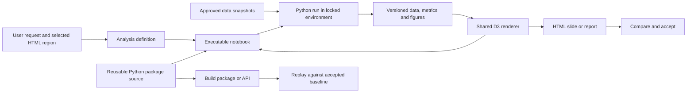

# Report-first scientific projects

Status: first working implementation on the development branch; the sections
below describe the broader architecture, including work not yet implemented.
See [the current workflow and limits](analysis-projects.md) for shipped behavior
on this branch: normal workspace tabs, approved file snapshots, project-local uv
execution, existing Claude/Codex terminal chat on the right, linked Jupyter notebooks, review/replay,
audit export, and wheel/API generation with reproduction checks.
Branch: `feature/report-first-analysis`, based on `899b79c` from `main`.

Start with a question and an HTML report or slide deck. The agent creates the
analysis needed to support that document. Every linked figure, table, and number
can be traced to approved input data, reusable Python, an executed notebook, and
a recorded environment. The analyst can inspect, rerun, revise, compare, and
later package that analysis without rebuilding it by hand.

This adds a project layer around GusNotebook's existing editors and execution
features. HTML is the primary authoring surface; `.ipynb` and `.gspy` remain
available as executable analysis documents. The implementation must preserve the
current notebook and HTML workflows while this branch develops.

## The user experience

1. Open the normal Claude/Codex terminal chat and ask for a slide deck or report. Choose a new project
   directory, or explicitly adopt an existing document into a project.
2. Select the files the agent may use, directly or through a JSON file listing
   their paths. The application shows the resulting data scope.
3. Select a slide, paragraph, or placeholder and ask for an analysis, such as
   “Show PCA for these measurements and report explained variance.”
4. The agent inspects approved data, proposes its analytical choices, and creates
   readable Python modules, a notebook that calls them, and a locked uv project.
   Scientific ambiguities such as outcome definitions, exclusions, and missing
   value handling are recorded and resolved with the analyst.
5. A controlled runner executes the analysis. Python produces data and metrics;
   a shared D3 renderer displays them in both the notebook and the HTML.
6. Click a result to see its inputs, parameters, source, environment, notebook,
   run, and interaction history. Ask for a correction from that same location.
7. Compare the new analysis and report with the previously accepted version.
   Accept or retain the previous result. Later, ask to build a reusable Python
   package or API from the same implementation.



The diagram shows how artifacts flow. Rendering a report never runs Python.
A report binding follows an explicitly selected successful run, not whatever
happens to be in a notebook's current kernel.

## Existing foundations and gaps

| Area | Available in the repository | Required project capability |
| --- | --- | --- |
| HTML editing | `static/markup-tools.js`, `static/markup-runtime.js`, and `preview.py`; selected regions exposed through `/api/here` | Stable report-element identities, project result bindings, targeted updates and comparison |
| D3 | `plotting.py` guidance and bundled D3 in notebook output frames | One renderer module and input contract shared by notebook and report |
| Provenance | `cellhistory.py` and `provenanceHtml()` carry copied source, output and run receipts into HTML | Bindings created from the HTML first, with input and environment lineage |
| Execution | `kernel.py`, `gspy.py`, and `gspy_content.py` record producing revisions and ordered runs | Clean project runs with declared inputs, dependency fingerprints and uv execution |
| Environments | `environments.py` creates uv venvs and lists installed packages | Project `pyproject.toml`, `uv.lock`, Python/runtime records and exact restoration |
| Agents | Terminal agents, selected-target context and recorded requests | Project chat with structured tool calls and durable visible interaction history |
| Access rules | Agent instructions and provider-specific terminal deny rules | Enforced per-project data access for all tools, subprocesses, kernels and previews |

The current environment creator uses `uv venv` and `uv pip install`; it does not
create a locked analysis project. Existing GSPY run receipts contain code and
interpreter information but do not fingerprint all input files and dependencies.
Terminal scrollback is bounded and is not a complete conversation archive.
Existing provenance snapshots remain useful, but a copy receipt alone does not
establish the complete data-to-report dependency chain.

## Project structure

```text
project/
  gusproject.json                  # versioned project, analysis and report definitions
  pyproject.toml                   # package metadata and dependencies
  uv.lock                         # generated by uv, committed with code
  .python-version
  code/
    src/<project_package>/        # reusable analytical functions and pipelines
      __init__.py
      preprocessing.py
      analysis.py
      contracts.py
  data/
    inputs/<source_id>/<revision>/  # immutable copies of explicitly approved files
    derived/<run_id>/              # versioned processed tables and D3 payloads
  results/
    runs/<run_id>/                 # metrics, figures, executed notebook, run receipt
    comparisons/<comparison_id>/   # numerical, structural and rendering differences
  environment/
    runtime.json                  # Python, uv, OS/architecture and runtime identity
    .venv/                        # recreated locally; never committed or copied between machines
  notebooks/
    analysis.ipynb                # ordered calls into code/, inspection and display
  reports/
    deck.html
    views/                        # shared D3 modules and view configuration
    assets/                       # pinned local rendering dependencies
  tests/
    test_analysis.py
    test_reproduction.py
  audit/
    events.jsonl                  # durable project interaction and execution events
```

Use one root `pyproject.toml` and `uv.lock`, with package discovery configured for
`code/src`. The notebook imports that package; avoid duplicated analytical
implementations inside report scripts and notebook cells. Libraries accept data
and parameters rather than reading hard-coded machine paths. File resolution
belongs to the project runner. Kernels start with the project root as their
working directory.

The application sets `UV_PROJECT_ENVIRONMENT=environment/.venv` consistently
when preparing the project and selecting its notebook interpreter. This is a
supported uv configuration; the environment location is not a second dependency
specification. [uv project configuration](https://docs.astral.sh/uv/concepts/projects/config/#project-environment-path).

Raw data, derived data, machine-specific source paths, environments, and
potentially sensitive conversation logs are excluded from automatic Git commits.
The project manifest records portable IDs and digests. Exporting a reproducible
bundle includes an explicit choice of data and audit artifacts. A bundle missing
its required data reports that limitation rather than claiming a successful replay.

## Approved data and execution permissions

An initial user-supplied source list can look like this:

```json
{
  "sources": [
    {"id": "measurements", "path": "/approved/location/measurements.parquet"},
    {"id": "sample_metadata", "path": "/approved/location/samples.csv"}
  ]
}
```

Paths are resolved on the computer running the project, including when connected
through a tunnel. Local and remote paths are not interchangeable. The UI must
identify that host before registering a source.

A trusted application service resolves and snapshots exactly those files. It
records the original locator, content digest, size, format, schema and approval
revision. The project sees logical input IDs and versioned snapshots under
`data/inputs`. Selecting a file does not authorize its parent directory. A changed
source creates a new input revision; it does not replace an accepted snapshot.

The broker stores approvals, run snapshots and history outside the editable project.
Changing `gusproject.json` does not change that registry. Registering new sources
requires an explicit user action. Symlink and source-replacement checks protect
registration; these do not prevent a host process from accessing other files.

The selected implementation uses **uv and the existing terminal agent**. Each
project has `environment/.venv` and `uv.lock`; fresh Python subprocesses load
approved snapshots. Runs have bounded output, cancellation and timeouts. Before
execution, uv reconciles installed packages with the lock. Notebook kernels and
project terminals can use this same interpreter.

uv isolates packages, not filesystem or network access. Terminal agents and Python
run with host permissions. Instructions require approved inputs, but are not an
access-control boundary. The earlier Docker-only runner and separate gateway-chat
proposal have been superseded; Docker is not required. A future enforced-data-only
mode would need a separately designed OS security boundary, including agent tools
and credentials, and must be described separately from this uv workflow.

The same Claude/Codex terminal UI and login are reused. `gusnb project` exposes
context, revision-checked analysis/report edits, execution, replay, results and
response notes. Source approval and acceptance remain user review actions. Prompt
hooks and broker operations record requests and changes; assistant explanations
are persisted with `gusnb project note`. Direct host edits and full terminal output
are not automatically a complete project transcript.

The HTML preview remains an opaque sandbox with a restrictive network policy.
Validated results flow through the shared renderer into HTML and notebooks.

## Analysis and report contracts

An analysis definition identifies its code entry point, declared input IDs,
parameters, prerequisites, output schemas and associated notebook/cell IDs.
The application assigns stable identities independent of filenames and DOM order.

A report binding conceptually contains:

```json
{
  "element_id": "pca-panel",
  "analysis_id": "cohort-pca",
  "accepted_run_id": "run-0042",
  "output": "pca_coordinates",
  "renderer": "views/pca.js",
  "renderer_revision": "sha256:...",
  "notebook_id": "notebook-0007"
}
```

This is an illustrative contract, not a supported file format yet. The trusted
project registry resolves these IDs. Browser-supplied paths or IDs are references,
not authority to open a notebook or invoke a computation.

The same mechanism supports a linked inline number such as an effect estimate,
confidence interval, or sample count. Its binding includes the output field,
formatting and units. Free text remains editable. A manually typed number is not
a verified analysis result merely because it appears beside a linked figure.
Editing generated output detaches it or marks it modified; it must not retain a
false “verified” status.

Python owns scientific transformations, statistics and model fitting. D3 consumes
versioned, schema-validated results for presentation. Shared view modules provide
the same plot in the notebook and report. Display formatting and exploration
controls can run in JavaScript; changes to the analytical population or method
become explicit parameters and new Python runs.

Opening a report uses its saved artifacts. Clicking **Analysis** opens the exact
producing code and input/environment records, with **Open notebook**, **Rerun**,
**Compare**, and **History** actions. Opening the current editable notebook is
clearly distinguished from viewing the notebook snapshot of the producing run.

The agent patches only the selected report element, using the expected document
revision. Concurrent human edits cause a conflict, preserving both versions.
Renderer changes and scientific changes have separate revisions, so changing a
color does not masquerade as a new analysis or silently rerun Python.

## Reproduction, comparison and human review

A persisted run receipt includes:

- Project, analysis and request IDs; timestamps, status and visible tool activity.
- Exact input and upstream artifact digests, schema, parameters and random seeds.
- Code snapshot, notebook and stable cell IDs; Git revision plus a content digest
  for uncommitted source, rather than Git revision alone.
- `pyproject.toml` and `uv.lock` digests, installed distributions, interpreter and
  platform details; runtime image/system-library/GPU information when applicable.
- Output artifact paths, roles, schemas and digests; execution logs and failures.
- Renderer source/configuration/dependency revisions and report binding changes.

Use `uv sync --locked` to prepare an exact project environment and locked commands
for replay. uv documents that `--locked` rejects stale lockfiles rather than
updating them; a package list or `--frozen` alone is not the same validation.
[uv locking and syncing](https://docs.astral.sh/uv/concepts/projects/sync/).

Verified replay starts from a fresh process/kernel and declared prerequisites,
without ambient notebook state. Prepared runtime snapshots must not change
under a running analysis. Record external/system dependencies and hardware where
relevant: locking Python packages and setting a seed do not promise identical
floating-point results across all machines.

Keep the accepted run and report revision as the baseline. Execute a proposed
change into new staging locations; finalize artifacts and the run receipt before
exposing a candidate. Failures or interrupted writes never replace the accepted
report. Acceptance updates its bindings atomically with a recorded review event.
The authoritative baseline is protected from agent writes.

Comparison covers three distinct questions:

| Check | What it establishes |
| --- | --- |
| Scientific outputs | Matching schema, rows, identifiers, metrics and arrays under predeclared tolerances; exact equality where appropriate |
| Method and lineage | Differences in inputs, exclusions, parameters, code, dependencies and execution order |
| Presentation | Differences in HTML structure, text, renderer configuration and screenshots under a recorded browser/font/viewport setup |

A plot looking the same does not prove its numbers match. A changed scientific
method may correctly produce different results; show that difference and its
rationale. Tolerances are recorded before comparison, and an agent cannot widen
them merely to turn a failed replay into a pass.

Edits to an input revision, source dependency, parameter or environment mark the
affected analysis/report results outdated. Missing inputs or undeclared runtime
reads are explicit failures. Refreshing dependency status never silently edits
prose, accepts a new baseline, or runs code while opening a report.

## Readable code and promotion to a general package or API

Start with reusable Python under `code/src` even during exploration. Functions
have explicit inputs and outputs, validation, concise domain-relevant docstrings,
and tests for behavior. Keep file access, scientific logic, rendering and HTTP
transport separate. Notebooks explain the analysis and call this implementation.

Use scikit-learn itself for appropriate preprocessing and learning tasks, such as
`Pipeline`, `ColumnTransformer`, `StandardScaler` and `PCA`. Custom estimators
follow `fit`/`transform`/`predict`, parameter inspection and cloning conventions,
and use the appropriate estimator checks. Ordinary descriptive calculations can
remain functions; a mean or table summary does not need an artificial estimator.
[scikit-learn estimator development](https://scikit-learn.org/stable/developers/develop.html)
and [pipeline composition](https://scikit-learn.org/stable/modules/compose.html).

Promotion is a build and verification workflow over that source:

1. Define a public input schema and configurable parameters. Separate fit from
   application to new data, and keep learned preprocessing inside the pipeline
   to avoid evaluation leakage.
2. Build an installable, versioned wheel with tests and a minimal usage example.
3. In a clean environment, execute the original analysis through the installed
   package and compare it against the accepted baseline.
4. Test independent synthetic or approved fixtures with different row counts,
   values, feature mappings and invalid inputs. Matching only the original
   dataset cannot establish a reusable interface.
5. Optionally add a thin, versioned HTTP adapter calling the same library. It
   accepts validated data or scoped uploaded-artifact IDs and parameters, not
   arbitrary host paths, and returns the same result contract plus run identity.
6. Update notebook and report bindings to the package-produced run after review,
   retaining the original run and the comparison record.

“General” means reusable for the declared domain/schema, without embedded cohort
values, machine paths or slide-specific assumptions. It does not mean every
possible dataset. Packaging a library, exposing an API, and deploying a public
service are separate actions; promotion need not publish anything externally.

## Durable history

Project chat records visible user messages, assistant responses, tool calls and
results, target identities, instruction/policy revisions, code/report diffs,
run receipts, comparisons and acceptance decisions. Preserve cancellations and
failures as well as successes. Do not rely on terminal screen replay or claim to
capture model-internal reasoning.

Use one project event stream with stable event/run IDs. Existing notebook journals
remain their source records; project events reference them and add cross-document
links, rather than pretending a single cell journal contains the entire project.
Large artifacts are stored once and referenced by digest. Event writes and run
finalization are recoverable across restarts and idempotent on retries.

The broker owns authoritative records; `audit/events.jsonl` is the portable
projection/export. Hashes support integrity checks but do not make a local log
immutable or independently authenticated. Stronger signing/retention guarantees
are a distinct future feature, not an implication of the word “audit.”

## Implementation stages and acceptance gates

| Stage | Deliverable | Gate before moving on |
| --- | --- | --- |
| 1. Project foundation | `projects.py`/`project_routes.py`, versioned manifests, non-destructive scaffolding, source registration and uv lock/runtime preparation | Required folders exist; existing files are never overwritten; exact input revisions and dependencies are recorded and portable |
| 2. uv runner | Project-local locked environment, fresh subprocesses, run records and cancellation | Approved snapshots are loaded, versions recorded, replay checked, and interruption preserves prior results; host permissions are explicit |
| 3. One HTML-to-analysis workflow | Project chat, scoped agent tools, one notebook, shared D3 renderer and targeted HTML bindings | Request a PCA from a selected HTML region using one approved dataset; inspect and rerun the producing notebook; no hand copying or unlinked hard-coded metrics |
| 4. Review and replay | Dependency invalidation, baseline retention, numerical/method/report comparisons and recovery | Change a source value or parameter; explain what changed; retain original on failure or rejection; accept a verified candidate without overwriting unrelated HTML |
| 5. Package/API promotion | Build from the same analysis code, estimator checks where applicable, independent-data tests and optional HTTP adapter | Installed package reproduces the baseline; general input contract works on independent data; API and notebook call the same implementation |
| 6. Integration and scale | Adopting existing projects, richer agent adapters, large datasets, remote environments, export and retention policy | Local/remote host semantics remain explicit; no regressions in ordinary notebooks, Quill documents, HTML editing, terminals or tunnels |

These module names and stages are proposed, not implemented interfaces. Add
separate Flask blueprints and frontend modules instead of continuing to grow
`app.py` and `cells.js` with all project behavior.

The first working demonstration is deliberately one complete path: create a deck
from project chat, authorize a CSV or Parquet file, run a scikit-learn PCA pipeline,
show its coordinates and explained variance with D3, follow the HTML links back
to its notebook and environment, and replay it in a clean worker. Stage 4 then
adds an accepted baseline and a changed-data comparison. No broad “fully
reproducible” claim is made before those gates pass.

## Scope decisions for the first implementation

- Retain the current HTML editor as the presentation surface; no new slide-canvas
  framework or conversion to Quill is required for reports.
- Use explicit dataset and output declarations before attempting automatic
  inference of arbitrary Python file dependencies.
- Begin with local files on the workspace host and the uv execution backend.
  Live databases, remote object stores and zero-copy large inputs require their
  own versioning and access adapters later.
- Add structured project chat and a scoped tool interface. Validate provider
  integration before promising parity with every embedded terminal agent.
- Preserve existing workflows during development. Existing files are adopted
  explicitly; opening one does not relocate data or restructure its repository.

This project layer extends the execution and provenance work in the
[GSPY implementation plan](gspy-implementation-plan.md). Component-aware agent
capture, report export and activity tracking should use shared project identities
as they are implemented, rather than create competing provenance systems.
